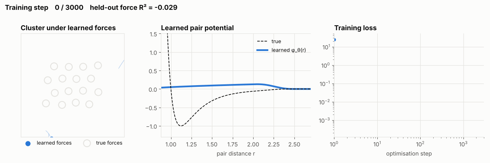
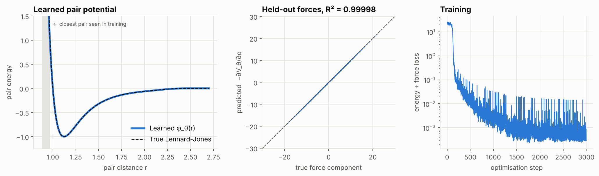
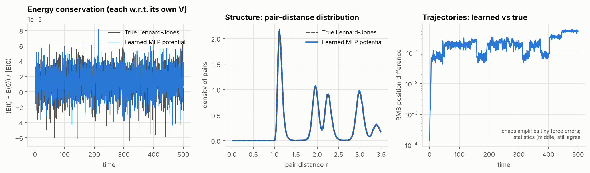
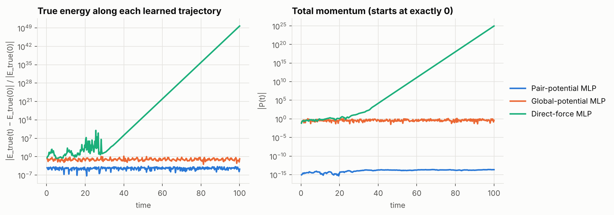

# Equinox-MLP

**Learn a potential energy with an Equinox MLP, then integrate its autodiff forces.**

```math
V_\theta(q) = \sum_{i \lt j} \varphi_\theta(r_{ij}) \qquad F_\theta = -\nabla_q V_\theta \qquad (q, p) \leftarrow \text{Verlet}(F_\theta)
```

`eqxmlp` trains a small [Equinox](https://docs.kidger.site/equinox/) MLP to reproduce the interatomic potential of a Lennard-Jones cluster. It then runs molecular dynamics with forces obtained by differentiating the network, using the same velocity-Verlet integrator and `jax.lax.scan` rollout that drive the ground-truth simulation.

- **The network learns an energy, not forces.** Forces are `-jax.grad` of the MLP, so they are conservative by construction.
- **Force matching = a gradient of a gradient.** The loss contains `jax.grad`, and training differentiates it again with `eqx.filter_value_and_grad`.
- **Symmetry by architecture.** The MLP sees only pair distances, so energy is invariant to translation, rotation and relabelling atoms. Momentum and angular momentum are then conserved to round-off.
- **One integrator for every force field.** `simulate(force_fn, ...)` doesn't care whether forces come from the true potential, a learned one, or a network that predicts forces directly. That makes the comparisons fair.

### Watch it learn

<p align="center"></p>

> Each frame is a snapshot of the model during training. **Left:** the 16-atom cluster simulated for 10 time units from the same start with that snapshot's learned forces; hollow rings show where the true forces put the atoms. **Middle:** the learned pair potential. **Right:** the loss so far. Untrained, the forces barely hold anything and atoms drift away. Around step 100 the loss collapses, the potential snaps onto the true curve, and from then on the learned cluster tracks the true one. Made by `examples/training_timelapse.py`, or from your own training run in the notebook (section 4b) with `em.render_timelapse`.

<p align="center"></p>

> A 2,545-parameter MLP recovers the Lennard-Jones pair potential from energies and forces alone. On **held-out trajectories** its autodiff forces reach **R² = 0.99998** (RMSE 0.019, against a typical force size of 4.5). Trained in 71 s on a CPU.

---

## Contents

- [Quickstart](#quickstart)
- [The method](#the-method)
- [Results](#results)
- [Why a symmetric potential? Baselines](#why-a-symmetric-potential-baselines)
- [How the JAX and Equinox pieces fit](#how-the-jax-and-equinox-pieces-fit)
- [Testing](#testing)
- [Repository layout](#repository-layout)
- [Limitations](#limitations)
- [References](#references)

## Quickstart

```bash
git clone https://github.com/sjd18/Equinox-MLP.git
cd Equinox-MLP
pip install -e ".[examples]"
```

> **Guided tour:** open [`notebooks/quickstart.ipynb`](notebooks/quickstart.ipynb) (`jupyter notebook notebooks/quickstart.ipynb`). It walks through data, training, simulation and the physics checks, with plots. It's also readable directly on GitHub.

The whole pipeline in a few lines:

```python
import jax

jax.config.update("jax_enable_x64", True)

import eqxmlp as em

# 1. Data from the true physics: 32 Lennard-Jones MD runs, vmapped.
data = em.generate_dataset(jax.random.PRNGKey(0))  # positions, energies, forces

# 2. An Equinox MLP pair potential, trained by force matching.
model = em.PairPotentialMLP(width=48, depth=2, key=jax.random.PRNGKey(1))
model, losses = em.train(model, data, key=jax.random.PRNGKey(2), steps=3000, batch_size=64)

# 3. Integrate the learned forces with velocity Verlet under lax.scan.
start = em.initial_state(jax.random.PRNGKey(7))
traj = em.simulate(model.forces, start, dt=0.005, n_steps=100_000, save_every=50)

E = em.total_energy(model.energy, traj)
print(abs(E - E[0]).max() / abs(E[0]))  # ~9e-5: energy is conserved
print(abs(em.total_momentum(traj.p)).max())  # ~5e-14: so is momentum
```

Reproduce every figure:

```bash
python examples/train_pair_potential.py   # train, evaluate, save checkpoints/pair_potential.eqx
python examples/simulate_learned.py       # MD with learned vs true forces
python examples/baselines.py              # compare with unstructured MLPs
python examples/training_timelapse.py     # the GIF above (retrains with snapshots, ~2 min)
```

A trained checkpoint is included in `checkpoints/`, so the last two scripts run without retraining.

## The method

**Ground truth.** 16 atoms in 2-D interacting through a Lennard-Jones pair potential, multiplied by a C² switching function `S(r)` that brings energy and force smoothly to zero between `r = 2.0` and `r = 2.5`:

```math
\varphi_{\text{LJ}}(r) = 4\varepsilon\left[\left(\tfrac{\sigma}{r}\right)^{12} - \left(\tfrac{\sigma}{r}\right)^{6}\right] S(r)
```

**Data.** `generate_dataset` runs 32 independent simulations in parallel (`jax.vmap` over initial velocities, at temperatures from 0.21 to 0.49), samples a frame every 40 steps, and labels each one with the true energy and the true forces `-jax.grad(V)(q)`. That gives 2,912 training frames. A separate set of 8 trajectories (728 frames) is held out for testing.

**Model.** `PairPotentialMLP` wraps an `eqx.nn.MLP` with inputs `[r, 1/r]`, two hidden layers of 48 SiLU units, and a scalar output:

```math
\varphi_\theta(r) = \text{MLP}_\theta\!\left(r, \tfrac{1}{r}\right) \cdot S(r), \qquad V_\theta(q) = \sum_{i \lt j} \varphi_\theta(\lvert q_i - q_j \rvert)
```

The `1/r` input makes the steep repulsive wall easy to represent; `S(r)` gives the model the same cutoff as the truth.

**Training: force matching.** The loss compares both energies and forces:

```math
\mathcal{L}(\theta) = \Big\langle \big(\tfrac{V_\theta(q) - V(q)}{N}\big)^2 \Big\rangle + \Big\langle \lVert -\nabla_q V_\theta(q) - F(q) \rVert^2 \Big\rangle
```

Because the force term is itself a gradient, `∂L/∂θ` is a mixed second derivative. In code, that's just `eqx.filter_value_and_grad(loss_fn)` around a loss that calls `jax.grad`. Optimiser: Adam with cosine decay, 3,000 minibatch steps.

**Integration.** Velocity Verlet (kick, drift, kick) with the force carried between steps, so each step costs one force evaluation. A nested `lax.scan` compiles a 100,000-step run into one loop and keeps only every `save_every`-th frame.

## Results

<p align="center"></p>

The same initial condition (not in the training data), run for 100,000 steps (t = 500) with each force field:

| | True Lennard-Jones forces | Learned MLP forces |
|---|---|---|
| Max relative energy error (each w.r.t. its own V) | 6.6 × 10⁻⁵ | 8.1 × 10⁻⁵ |
| Max total momentum | 6.3 × 10⁻¹⁴ | 3.8 × 10⁻¹⁴ |
| Max angular momentum | 1.6 × 10⁻¹³ | 8.2 × 10⁻¹⁴ |
| Wall time, 100k steps (CPU) | 0.5 s | 4.9 s |

- **Energy** is conserved with learned forces as well as with true ones. The error oscillates and doesn't drift.
- **Structure** (middle panel) is indistinguishable: the pair-distance distributions overlap peak for peak.
- **Exact trajectories** separate (right panel). MD is chaotic, so the tiny remaining force error is amplified until the two runs are in different microstates. That's expected; the statistics are what a potential has to get right.

## Why a symmetric potential? Baselines

`examples/baselines.py` trains two unstructured alternatives on the same data and integrates them with the same code:

- **Global-potential MLP:** `V_θ = MLP(all coordinates)`. Still a potential, so its forces are conservative, but it has no built-in symmetry.
- **Direct-force MLP:** `F_θ = MLP(all coordinates)`. Predicts forces directly, with no energy behind them.

<p align="center"></p>

| Model | Params | Train steps | Held-out force R² | Max true-energy error | Max momentum |
|---|---|---|---|---|---|
| **Pair-potential MLP** | 2,545 | 3,000 | **0.99998** | **2.5 × 10⁻⁴** | **2.4 × 10⁻¹⁴** |
| Global-potential MLP | 37,377 | 20,000 | 0.460 | 1.6 | 1.3 |
| Direct-force MLP | 41,376 | 20,000 | 0.376 | 5 × 10⁴⁹ (diverges) | 9 × 10²⁴ |

**How to read this.** Both baselines underfit badly, even with 15× more parameters and ~7× more steps. A network on raw coordinates has to relearn the same interaction for every ordering and position of the atoms, and ~3k frames isn't enough. Their poor fit explains much of their rollout behaviour, so the table is mainly evidence for inductive bias. Two conclusions hold regardless of fit quality, though:

- **Learning a potential guarantees energy conservation, of the model's own energy.** The global-potential MLP conserves `T + V_θ` to 3 × 10⁻⁵ despite its R² of 0.46. The direct-force MLP has no energy to conserve, and its trajectory blows up.
- **Without symmetry, momentum is not conserved.** Only the pair model makes forces sum to zero (Newton's third law), so only its momentum stays at zero. The global-potential MLP's momentum wanders to order 1.

## How the JAX and Equinox pieces fit

| Idea | Where it lives | Source |
|---|---|---|
| Models are pytrees | `PairPotentialMLP` etc. are `eqx.Module`s wrapping `eqx.nn.MLP` | [Equinox](https://docs.kidger.site/equinox/) |
| Filtered transformations | `eqx.filter_jit` on `simulate` and the train step; `eqx.filter_value_and_grad` for the loss | Equinox |
| Serialisation | `eqx.tree_serialise_leaves` / `tree_deserialise_leaves` for `checkpoints/` | Equinox |
| Forces = `-grad` of an energy | `forces(V, q)`, `PairPotentialMLP.forces` | [Autodiff Cookbook](https://docs.jax.dev/en/latest/notebooks/autodiff_cookbook.html) |
| Gradient of a gradient | force-matching loss in `training.py` | Autodiff Cookbook |
| `vmap` over pairs and batches | `jax.vmap(phi)` over the N(N−1)/2 pairs; batched losses; parallel data generation | [Thinking in JAX](https://docs.jax.dev/en/latest/notebooks/thinking_in_jax.html) |
| Structured control flow | nested `lax.scan` in `rollout` | Thinking in JAX |
| Static vs. traced | `triu_indices`, `n_steps`, `save_every` are static; positions and weights are traced | Thinking in JAX |
| Hamiltonian structure | conservative forces from a learned scalar, as in Hamiltonian Neural Networks | [Greydanus et al. 2019](https://arxiv.org/abs/1906.01563) |

## Testing

```bash
pip install -e ".[dev]"
pytest -q        # 21 tests, ~35 s on CPU
```

The tests check physics properties, not just shapes:

- Autodiff LJ forces match a hand-written force loop; the pair sum matches brute force.
- The switching function is continuous in value, first and second derivative.
- Verlet with true forces conserves energy, momentum and angular momentum, and is time-reversible.
- Verlet calls the force function once per step.
- The pair model's energy is invariant to translation, rotation and permutation. Its forces rotate with the system, sum to zero and exert no net torque, **even untrained**.
- The global baseline breaks translation symmetry, as it should.
- The force-matching gradient (grad of grad) is finite and non-zero.
- A short training run recovers the LJ curve; the training callback sees every step; the timelapse renders a valid GIF.

## Repository layout

```text
src/eqxmlp/
  systems.py       Lennard-Jones ground truth, pair sums, cutoff, initial conditions
  models.py        PairPotentialMLP (main), GlobalPotentialMLP, DirectForceMLP
  integrators.py   velocity Verlet, nested lax.scan rollout, simulate()
  data.py          vmapped MD data generation (positions, energies, forces)
  training.py      force-matching loss, Optax training loop, evaluation
  diagnostics.py   energy, momentum, angular momentum, pair-distance distribution
  timelapse.py     snapshot schedule + GIF of the cluster as the MLP learns
examples/          scripts that produce every figure in this README
notebooks/         quickstart.ipynb: guided tour with plots and a training timelapse
checkpoints/       trained pair potential (Equinox serialised) + hyperparameters
tests/             pytest suite (float64)
assets/            generated figures
```

## Limitations

- **Extrapolation.** The closest pair in the training data is at r ≈ 0.97. Below that, the learned wall is softer than the truth (at r = 0.85 it predicts φ ≈ 9 instead of 17.5). Simulations hotter than the training data could push atoms into that region. Train on hotter data, or add a known repulsive term, if you need it.
- **Pairwise only.** `φ_θ(r)` can represent any pair potential but not many-body effects such as bond angles. For those, a message-passing or descriptor-based model would be the next step.
- **Free cluster, O(N²).** No periodic box or neighbour lists; fine for tens to hundreds of atoms.

## References

1. P. Kidger, C. Garcia. *Equinox: neural networks in JAX via callable PyTrees and filtered transformations.* [docs.kidger.site/equinox](https://docs.kidger.site/equinox/)
2. JAX documentation: [Thinking in JAX](https://docs.jax.dev/en/latest/notebooks/thinking_in_jax.html) and [The Autodiff Cookbook](https://docs.jax.dev/en/latest/notebooks/autodiff_cookbook.html).
3. S. Greydanus, M. Dzamba, J. Yosinski. *Hamiltonian Neural Networks.* NeurIPS 2019. [arXiv:1906.01563](https://arxiv.org/abs/1906.01563)
4. J. Behler, M. Parrinello. *Generalized neural-network representation of high-dimensional potential-energy surfaces.* Phys. Rev. Lett. 98 (2007).
5. F. Ercolessi, J. B. Adams. *Interatomic potentials from first-principles calculations: the force-matching method.* Europhys. Lett. 26 (1994).
6. E. Hairer, C. Lubich, G. Wanner. *Geometric Numerical Integration.* Springer, 2006.

## License

MIT; see [LICENSE](LICENSE).
